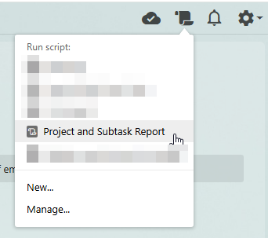
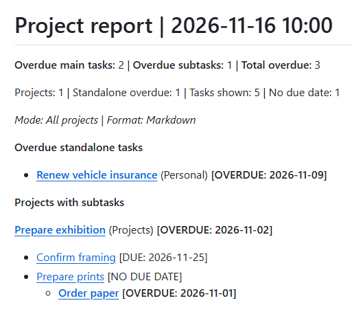

# Project and Subtask Report

A script for [Remember The Milk MilkScript](https://www.rememberthemilk.com/services/milkscript/).



## Project and Subtask Report

Keep track of overdue tasks across all your Remember The Milk projects, including projects with multiple levels of nested subtasks.

Rather than simply listing overdue tasks, this MilkScript produces a **structured project report** that shows what needs attention, where it belongs and the outstanding work associated with it.

### Key features

- **Complete project hierarchy:** Displays projects and all their incomplete subtasks, including subtasks within subtasks, to any nesting depth.
- **Two reporting modes:**
  - **OVERDUE:** Shows only projects where the main task or at least one incomplete subtask is overdue. Includes all remaining incomplete subtasks within those projects for context.
  - **ALL:** Shows every project containing incomplete subtasks, whether overdue or not.
- **Overdue standalone tasks:** Included automatically in both modes, in a separate section at the beginning of the report.
- **Intelligent sorting:**
  - Standalone overdue tasks are sorted by due date, oldest first.
  - Projects containing overdue work are sorted by the **earliest overdue date anywhere in their hierarchy**, even if the main task itself isn't overdue.
  - Projects without overdue work appear afterwards, alphabetically.
  - Subtasks retain their original Remember The Milk order and hierarchy.
- **Useful summary:** Separately counts overdue main tasks, overdue subtasks, total overdue tasks, projects, standalone overdue tasks, tasks displayed and tasks without due dates.
- **Direct task links:** Open any task directly in Remember The Milk, with its original list name shown beside main tasks.
- **Two output formats:** Choose Markdown for formatted headings, links and nested lists, or plain text for simpler viewing and copying.
- **Completed tasks excluded:** Reports only outstanding work without changing the original tasks.

### Daily reports without clutter

The script maintains a single report task in your chosen Remember The Milk list.

- The report task title includes the date of the latest run.
- Each day's report is stored as a separate dated note.
- Running the script again on the same day **updates the existing note** rather than creating a duplicate.
- Each note records the latest run time.
- Previous daily reports remain available for reference.

The result is a practical overview of overdue work, with enough project context to help you decide what to tackle next.


### Installation

1. In RTM, open **MilkScript** and create a script.
2. Paste the **entire contents** of [`project-report.js`](project-report.js) into the MilkScript editor.
3. Set these constants near the top as needed:

   ```javascript
   const REPORT_NAME = 'Overdue Project Report';
   const DESTINATION_LIST_NAME = 'Inbox';
   ```

   The destination is the exact name of an existing RTM list, not a numeric ID.
4. Create **two string input parameters**, using these names exactly:

   | Parameter name | Valid values | Default in script |
   | --- | --- | --- |
   | `Project mode (ALL or OVERDUE)` | `ALL`, `OVERDUE` | `OVERDUE` |
   | `Report format (MARKDOWN or PLAIN)` | `MARKDOWN`, `PLAIN` | `MARKDOWN` |

5. Save and run the MilkScript manually. RTM presents string parameters as text boxes rather than dropdowns. Values are case-insensitive, and leading/trailing spaces are ignored. If RTM requires a value in each input, type your choices instead of leaving them blank.

### Report modes

- `ALL` includes every top-level task with an incomplete direct subtask, along with all overdue standalone tasks.
- `OVERDUE` includes projects whose parent or any incomplete descendant is overdue, along with all overdue standalone tasks. It includes the remaining incomplete descendants of each qualifying project for context.

A completed task is not included. A date-only due date becomes overdue the following day, while a task with a due time becomes overdue after that time passes. A top-level task without any incomplete direct subtasks is treated as standalone, even if it has completed subtasks.

### Output formats

- `MARKDOWN` produces compact summaries, bold names or overdue labels, nested bullets and linked task names.
- `PLAIN` produces simple indented text with task URLs on separate lines.

When copying Markdown from RTM into another editor, **Ctrl+Shift+V** (paste as plain text) may be needed to preserve the literal Markdown syntax.

See [`example-report.md`](example-report.md) for an illustrative report using fictional tasks.



### Safety and limitations

- The script does not change source tasks. It changes only the report task title and its notes.
- It validates input settings and task data, detects duplicate report tasks and daily notes, checks for circular task hierarchies and applies report size limits.
- RTM writes are not guaranteed to be atomic. If a task or note operation fails partway through, an earlier write may have succeeded.
- The default report task name is `Overdue Project Report`. To preserve reports from an earlier version, use that existing base name.
- No scheduled run is configured. You choose when to run it.

### Testing

The included script is the supplied working RTM version, unchanged. It has been used in RTM, but this GitHub copy has **not** been independently run in another RTM account. No external automated test suite is claimed for this copy. Test it with your own lists before relying on its output.

## Licence

[MIT](LICENSE).
